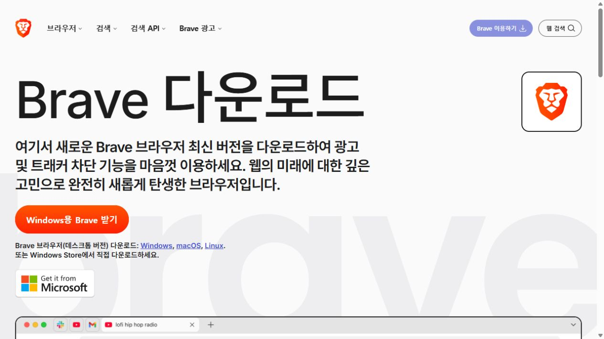

# Video Speed Menu

**Brave에서 비디오를 원하는 속도로 재생하는 확장 프로그램입니다.**

HTML5 비디오 위에 **1배속부터 4배속까지** 선택할 수 있는 메뉴를 표시합니다. 선택한 배속과 영상 진행량으로 계산한 실측 배속을 함께 볼 수 있습니다.

**[Brave용 확장 프로그램 ZIP 다운로드](https://github.com/seonil/video-speed-menu/releases/latest/download/video-speed-menu-brave.zip)**

Windows PC 기준 안내입니다. Chrome 웹 스토어 등록 없이, ZIP을 압축 해제한 폴더를 Brave에 등록하는 방식입니다. 한 번 등록한 폴더를 유지하면 브라우저를 재시작한 뒤에도 사용할 수 있습니다.

## 1. Brave 브라우저 설치

1. [Brave 공식 다운로드 페이지](https://brave.com/ko/download/)를 엽니다.
2. **Windows용 Brave 받기**를 누릅니다.
3. 내려받은 `BraveBrowserSetup.exe` 또는 `BraveBrowserSetup` 설치 파일을 실행합니다. 파일 이름은 배포 시점에 따라 다를 수 있습니다.
4. 설치가 끝나면 **Brave 브라우저**를 실행합니다.

이미 Brave를 사용 중이면 다음 단계부터 시작하세요. 휴대폰용 Brave를 대상으로 하는 안내는 아닙니다.



*Brave 공식 다운로드 페이지의 실제 화면입니다. 버튼 이름과 배치는 업데이트에 따라 달라질 수 있습니다.*

## 2. 확장 프로그램 다운로드와 압축 해제

1. [Brave용 ZIP 다운로드](https://github.com/seonil/video-speed-menu/releases/latest/download/video-speed-menu-brave.zip)를 누릅니다. GitHub 로그인은 필요하지 않습니다.
2. 내려받은 `video-speed-menu-brave.zip`을 마우스 오른쪽 버튼으로 누르고 **압축 풀기**를 선택합니다.
3. 압축을 푼 `video-speed-menu` 폴더를 계속 보관할 위치로 옮깁니다. 예: `문서\Browser Extensions\video-speed-menu`.
4. 폴더 안에 다음 파일이 바로 들어 있는지 확인합니다.

```text
video-speed-menu/
├─ manifest.json
├─ content.js
├─ INSTALL.txt
└─ LICENSE
```

**ZIP 파일 자체를 선택하거나 파일 하나만 실행하는 방식이 아닙니다.** 다음 단계에서 `manifest.json`이 들어 있는 폴더를 선택합니다.

## 3. Brave에 확장 프로그램 등록

1. Brave 주소창에 아래 주소를 붙여 넣고 Enter를 누릅니다.

   ```text
   brave://extensions/
   ```

2. 화면 오른쪽 위의 **개발자 모드**를 켭니다.
3. 위쪽에 나타나는 **압축해제된 확장 프로그램을 로드합니다**를 누릅니다. 영문 화면에서는 **Load unpacked**입니다.
4. 앞에서 압축을 푼 **`video-speed-menu` 폴더**를 선택하고 **폴더 선택**을 누릅니다.
5. 목록에 **Video Speed Menu**가 나타나고 사용 스위치가 켜져 있으면 등록된 것입니다.
6. 이미 열려 있던 비디오 페이지를 **새로고침**합니다.

설치한 뒤에는 이 폴더를 삭제하거나 이동하지 마세요. 별도의 툴바 팝업 대신, **영상 위에 배속 버튼이 직접 표시**됩니다.

## 4. 비디오 배속 사용

1. Brave에서 비디오가 있는 페이지를 엽니다.
2. 영상을 재생합니다.
3. 영상 **우측 상단의 `1×` 버튼**을 누릅니다.
4. 원하는 배속을 선택합니다.

| 선택 가능한 배속 | |
| --- | --- |
| 기본 속도 | 1× |
| 조금 빠르게 | 1.25×, 1.5× |
| 빠르게 | 2×, 3×, 4× |


*공개 안내용으로 직접 만든 HTML5 데모 영상에서 촬영한 실제 메뉴입니다. 특정 서비스의 화면이나 계정 정보는 포함하지 않았습니다.*

### 화면 표시 읽기

`설정 4× / 실측 4×`는 선택한 속도가 4배속이고, 최근 영상 진행량도 약 4배속이라는 뜻입니다. 실측 값은 재생을 시작하거나 배속을 바꾼 뒤 약 2초부터 표시되며, 최근 약 5초를 기준으로 갱신합니다.

실측 값이 설정 값보다 많이 낮으면 배경색이 주황색으로 바뀝니다. 버퍼링이나 플레이어의 속도 제한이 원인일 수 있습니다. 동영상 위치를 건너뛰면 측정을 다시 시작합니다.

### 선택한 배속 유지

기본으로 체크되어 있습니다. 플레이어가 속도를 변경하면 선택한 배속을 다시 적용합니다. 원래 플레이어의 배속 제어를 사용하고 싶다면 체크를 해제하세요. 기본 속도로 돌아가려면 **1×**를 선택합니다.

메뉴 버튼을 다시 누르거나 메뉴에 초점이 있을 때 **Esc**를 누르면 메뉴가 닫힙니다. 한 페이지에 영상이 여러 개면 화면에 보이는 재생 영상과 크기를 기준으로 한 영상을 선택합니다. 다른 영상으로 전환하면 그 영상의 현재 배속을 표시합니다.
